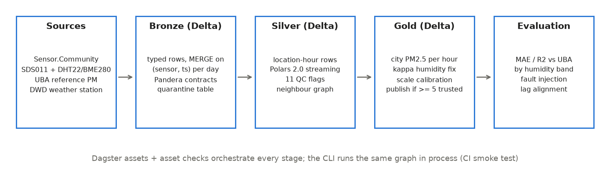
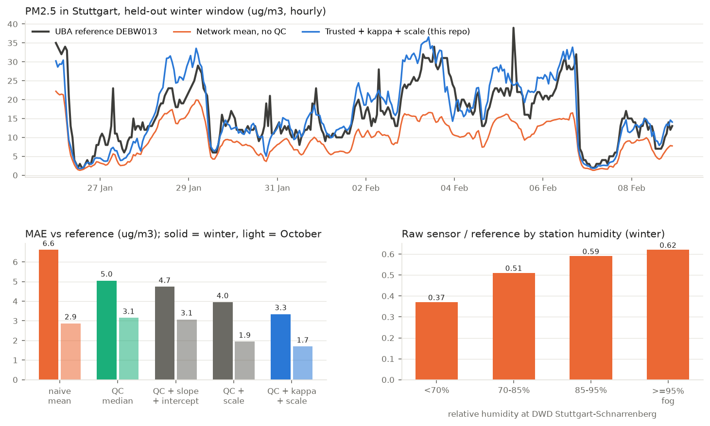

# pm-sensor-trust

Turns a citizen network of cheap PM2.5 sensors into an hourly city value you can put next
to an official station: every reading is quality checked, corrected for humidity with
data from a real weather station, calibrated once, and scored against the reference on
weeks it never saw. Built as a small lakehouse (Delta Lake tables written with Polars
2.0) orchestrated by Dagster, with data contracts and checks that fail the run when a
claim stops being true. Runs on a laptop, no API keys.

## The problem

Sensor.Community has tens of thousands of home-built PM sensors (an SDS011 particle
counter plus a DHT22 or BME280 for temperature and humidity). In Stuttgart alone there
are about 70 outdoor nodes inside 8 km of the centre. They are dense, free and real
time, which is exactly what official networks are not. But taken as they come they are
not usable as a measurement:

- the raw network mean against the official UBA station has R2 = 0.01 on a held-out
  winter fortnight and reads about half the reference value,
- sensors freeze, spike, lose their fan, or sit next to a chimney,
- optical counters read more in damp air because particles take up water, and the
  network's own humidity sensors are wrong often enough that you cannot use them to
  correct it (measured below),
- a calibration fitted in one season quietly stops working in the next.

This repo is the pipeline that sits between those files and anyone who wants to use
the numbers, and it measures how much each step is worth.

## Why now

- **Cheap sensors are being re-tested against reference stations right now.** On
  12 October 2026 a 10 month London study in Sensors compared low, mid and high cost
  monitors with three calibration methods. PM2.5 was the one that worked (R2 >= 0.56
  across sites after calibration), and calibrations trained in spring and summer no
  longer described winter data for the gases
  ([Mercado-Velazquez et al., Sensors 26(20) 6441, 12 Oct 2026](https://www.mdpi.com/1424-8220/26/20/6441)).
  This repo tests the same question on a public network: does a calibration from
  January still hold in October?
- **The EU deadline is in eight weeks.** Member states have to transpose the revised
  Ambient Air Quality Directive (EU) 2024/2881 by 11 December 2026, with stricter limits
  from 2030 (annual PM2.5 limit down to 10 ug/m3) and better public information
  ([HEAL, 7 Sep 2026](https://www.env-health.org/transposing-aaqd/)). Cities will need
  finer spatial coverage than the official stations give, and citizen networks are
  the obvious candidate if their data can be trusted.
- **Polars 2.0 shipped on 6 October 2026** with the streaming engine on by default and
  stricter schema behaviour ([release post](https://pola.rs/posts/release-polars-2/)).
  Every transformation here uses it, together with Delta Lake through delta-rs, so the
  whole lakehouse runs without a JVM.

## How it works

| Stage | What goes in | What comes out | Tooling |
|---|---|---|---|
| Ingest | area, dates | raw CSV per sensor per day, UBA JSON, DWD zip, cached in `data/raw` | stdlib HTTP with bounded retries, 8 workers |
| Bronze | raw files | typed readings, one row per sensor and timestamp; unparseable rows in `quarantine` with a reason | Polars 2.0, Pandera contracts, Delta `MERGE` per day partition |
| Silver | bronze tables | one row per location and UTC hour, PM joined with the node's humidity and the weather station's humidity, 11 QC flags | Polars window functions, k-nearest neighbour graph (haversine) |
| Calibrate | silver of the calibration window + reference | kappa (blocked CV) and one scale factor | NumPy |
| Gold | silver + calibration | city PM2.5 per hour: naive mean, QC median, corrected value, sensor counts, published flag | Delta `MERGE`, Pandera contract |
| Evaluate | gold + reference | MAE, RMSE, bias, R2 per variant and humidity band, time lag check, fault injection | NumPy |

Every stage is a Dagster asset; the claims are asset checks:
`enough_trusted_hours`, `publish_coverage`, `corrected_beats_naive`, `time_alignment`.

### Quality control rules (silver)

| Flag | Rule | Why |
|---|---|---|
| `f_range` | PM2.5 missing, negative, or PM above the SDS011 range (999) | hardware or parsing fault |
| `f_coverage` | fewer than 12 of the ~24 expected readings in the hour | node offline or rebooting |
| `f_flatline` | one repeated value for 3+ hours | frozen sensor or firmware |
| `f_pm_ratio` | PM2.5 above PM10 | physically impossible |
| `f_spike` | jump above the 5 h rolling median by more than 8 robust sigmas | insect, dust burst, glitch |
| `f_spatial` | log PM more than 4 robust sigmas from its 6 nearest neighbours for 3+ hours | local source or broken node |
| `f_drift` | weekly median ratio to the network outside 0.5 to 2 | fouled optics, persistent local source |
| `f_climate_missing`, `f_climate_invalid` | node humidity missing or outside physical range | diagnostics |
| `f_climate_offset` | node humidity more than 15 points from the DWD station | broken or saturated DHT22 |
| `f_fog` | station RH at or above 95% | marks hours where the humidity term is largest |

A location-hour is trusted when no PM flag is raised and station humidity exists. A city
hour is published when at least 5 locations are trusted. Humidity flags describe the
node's own humidity sensor and are reported, but they do not drop the PM value because
the correction uses the weather station (see [ADR 0003](docs/adr/0003-humidity-correction-model.md)).

### Humidity correction

    PM_dry = PM / (1 + kappa * aw / (1 - aw)),   aw = min(RH_station, 95) / 100
    PM_city = scale * median(PM_dry over trusted locations)

kappa is chosen on the calibration window with blocked two-fold cross validation (fit on
one week, score on the other), then a single scale factor is fitted on the whole window.
No intercept: a winter intercept does not transfer to autumn, measured below.

## Data

| Source | What | License | Downloaded |
|---|---|---|---|
| [Sensor.Community archive](https://archive.sensor.community/) | SDS011, DHT22, BME280 daily CSVs, 147 sensors on 73 outdoor nodes within 8 km of Stuttgart centre | ODbL 1.0 | 19 Oct 2026 |
| [UBA air data API](https://luftdaten.umweltbundesamt.de/) | hourly PM2.5 and PM10 at DEBW013 Stuttgart-Bad Cannstatt (urban background) | Datenlizenz Deutschland 2.0 (dl-de/by-2.0), source: Umweltbundesamt with data from LUBW | 19 Oct 2026 |
| [DWD Climate Data Center](https://opendata.dwd.de/climate_environment/CDC/) | hourly temperature and relative humidity, station 4928 Stuttgart-Schnarrenberg | CC BY 4.0, source: Deutscher Wetterdienst | 19 Oct 2026 |

Windows (`config.yaml`): calibration 12 to 25 January 2026, held-out winter 26 January to
8 February 2026, held-out autumn 1 to 17 October 2026. In total about 1.8 million PM
readings and 1.8 million humidity readings. All data is real; nothing is simulated
except the planted faults in the fault injection test, which are added on top of real
readings.

`sample_data/` holds a real slice (8 nodes, 7 days, gzipped in one flat folder, under 1 MB) with its own
`config.yaml`, used by the tests and the CI smoke run. Sensor coordinates are the public,
rounded positions published by Sensor.Community; no personal data is stored.

## Results

All numbers come from `pmtrust run` on the full windows (`results/metrics.json`,
`results/summary.md`). PM2.5 in ug/m3, every variant scored on the same hours against the
UBA station. Calibration fitted only on 12 to 25 January: kappa = 0.025, scale = 1.88.

| Variant | Winter held-out MAE / R2 | October MAE / R2 |
|---|---|---|
| Network mean, no QC | 6.61 / 0.01 | 2.87 / -0.06 |
| Network median, no QC | 6.75 / -0.05 | 3.34 / -0.30 |
| Median of trusted nodes | 5.05 / 0.35 | 3.15 / -0.19 |
| Trusted + slope and intercept (common practice) | 4.73 / 0.50 | 3.07 / 0.09 |
| Trusted + scale | 3.95 / 0.58 | 1.94 / 0.48 |
| **Trusted + kappa humidity + scale** | **3.34 / 0.68** | **1.69 / 0.59** |

Reference means: 16.1 (winter) and 6.5 (October). 335 and 407 hours, 100% of hours
published.

What the numbers say:

- QC plus correction halves the error on the held-out winter weeks (6.61 to 3.34) and
  cuts it by 41% in October, nine months after the calibration, with no refit.
- The common slope plus intercept calibration looks best in sample (MAE 3.73 on January)
  but its intercept is a winter background: in October it is no better than doing
  nothing. Fitting a scale only is what makes the calibration travel.
- The humidity term is small but consistent: 3.95 to 3.34 in winter and 1.94 to 1.69 in
  October. The raw sensor to reference ratio climbs from 0.37 below 70% RH to 0.62 in fog.
- The network's own humidity sensors are more than 15 points from the weather station
  in 36% to 50% of location-hours, which is why the correction uses the station.
- QC removes 17.5% to 23.8% of location-hours; most of that is `f_drift` (16% to 22%), nodes
  that sit at more than twice or less than half of the network for a week. Against an
  urban background station those nodes add error even when they are working.

Fault injection on the held-out winter window (real readings that passed QC, with
planted faults, seed 7):

| Fault | Hours | Caught | Recall | Rule that caught it |
|---|---|---|---|---|
| frozen value for 8 h (6 nodes) | 48 | 48 | 1.00 | `f_flatline` |
| single hour spike, 8x + 40 | 40 | 40 | 1.00 | `f_spike` |
| node reads 3x for two weeks (3 nodes) | 976 | 559 | 0.57 | `f_drift` |
| humidity sensor stuck at 14% (3 nodes) | 992 | 992 | 1.00 | `f_climate_offset` |

Clean hours flagged as a side effect: 0.48%. A constant 3x bias is the hard case: a node
that normally reads low ends up close to the network median and is invisible to any
rule that only uses the network itself.

## Run it

    python -m venv .venv && source .venv/bin/activate
    pip install -e ".[dev]"

    # offline, on the bundled sample (seconds)
    pmtrust run --raw sample_data/raw --lake /tmp/pm-lake --results /tmp/pm-results \
      --config sample_data/config.yaml

    # full study: download about 240 MB of raw files, then run (about 30 s on a laptop)
    python scripts/download_data.py
    pmtrust run
    pmtrust report          # docs/results.png, docs/architecture.png, results/summary.md

    # Dagster UI with the asset graph and checks
    dagster dev -m pmtrust.defs

    pytest -q               # 21 tests: QC rules, contracts, merge idempotency, the Dagster graph
    ruff check . && ruff format --check .

CI runs lint, the tests and the Dagster graph on the sample on every push.

## Repository layout

    pmtrust/
      ingest.py       downloads with retries and a local cache
      bronze.py       parsing, quarantine, Delta MERGE
      contracts.py    Pandera schemas for every layer
      silver.py       hourly aggregation, humidity join, neighbour graph
      qc.py           the 11 flags
      calibrate.py    kappa-Koehler correction, blocked CV, scale
      evaluate.py     scoring, lag check, fault injection
      pipeline.py     the stages as plain functions
      defs.py         Dagster assets and asset checks
      report.py       charts and summary
      cli.py          pmtrust run | report | sample
    scripts/download_data.py
    sample_data/      real 7 day slice for tests and CI
    results/          metrics.json, calibration.json, summary.md from the full run
    docs/             architecture.png, results.png, adr/

## Limitations

- One city, one reference station, about 2.5 months of data in three windows. The
  reference station is 0.3 to 13 km from the nodes; part of the remaining error is real spatial
  difference, not sensor error.
- The sensor list is a snapshot of nodes reporting on 19 October 2026, so nodes that died
  before that date are missing from the January windows (survivor bias toward healthy
  nodes).
- UBA labels hours in CET. The lag check peaks at -1, +1 and 0 hours in the three
  windows with very close correlations, so hour level timing against a station several
  kilometres away is only good to about an hour.
- The SDS011 does not see particles below about 0.3 um, so part of the winter gap is
  composition, not humidity. A single scale cannot follow a change in aerosol mix.
- `f_drift` uses the network median as its yardstick. It cannot catch a node that is
  wrong in a way that happens to land near the median.

## What I would do next

- Run it across several German cities with one reference station each and fit kappa per
  season with partial pooling instead of one global value.
- Turn the batch job into an hourly Dagster schedule with freshness checks and publish the
  gold table for a map.
- Use the trusted node set as features for spatial interpolation between official stations.
